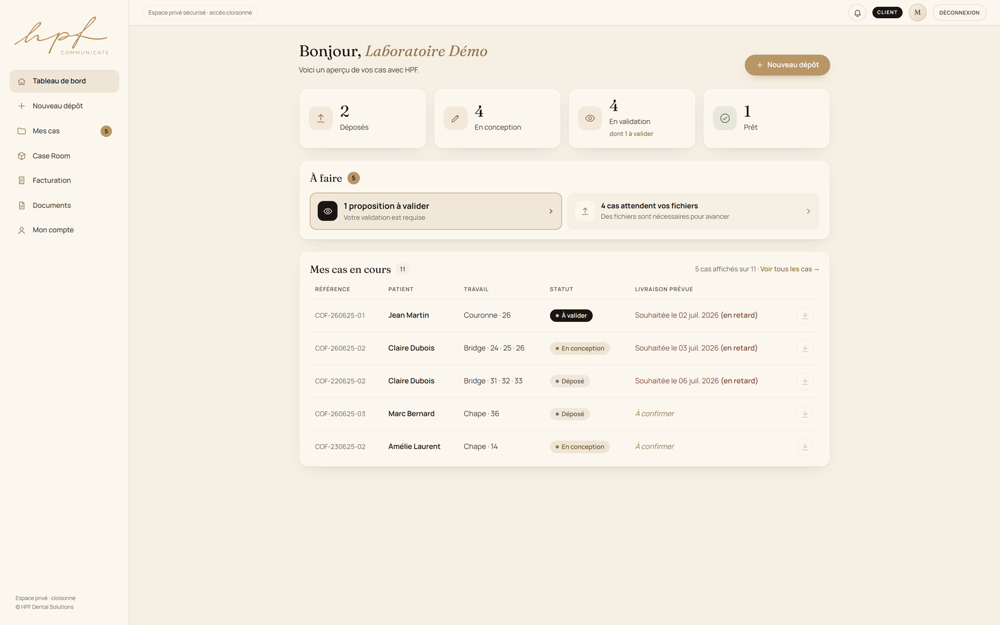
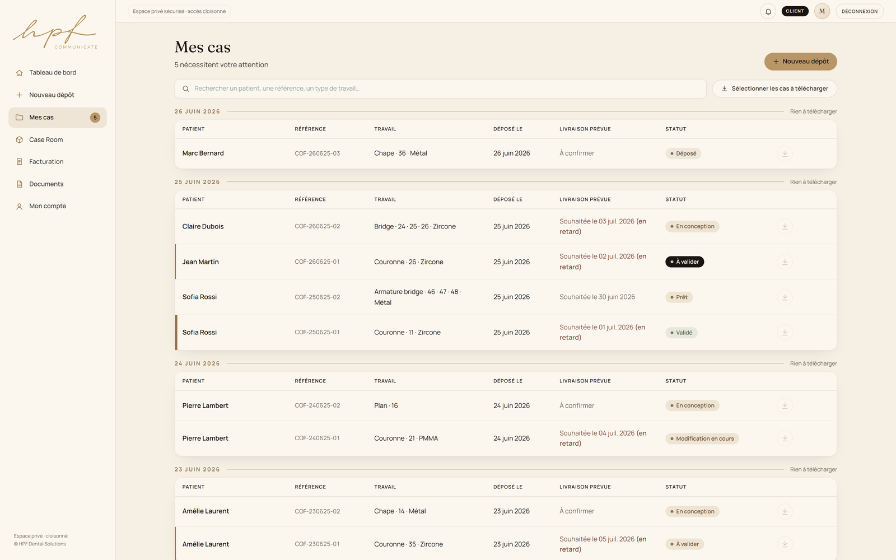
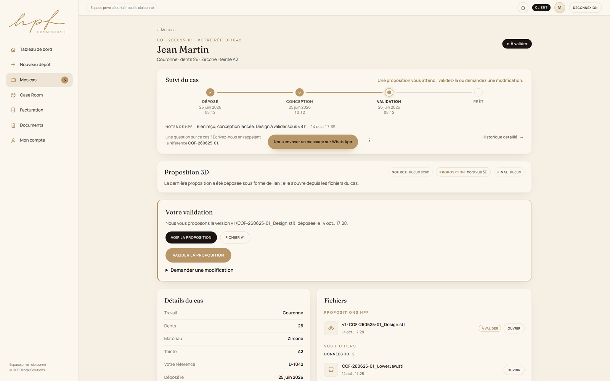
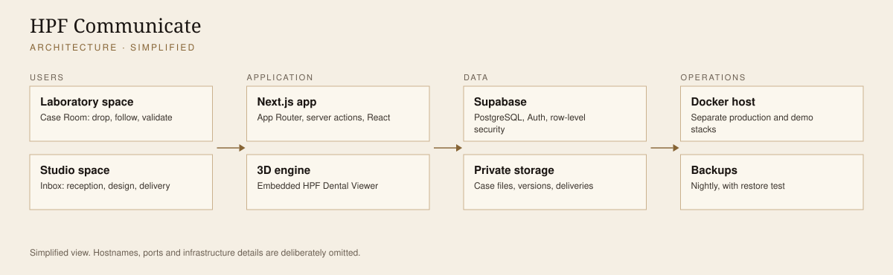

# HPF Communicate

> A private portal where dental laboratories and the design studio follow every prosthesis case.

**Status** · In production &nbsp;·&nbsp; **Area** · Clinical & Patient Experience &nbsp;·&nbsp; **Source code** · private, documentation only

### At a glance

- One view of every case, from drop to delivery.
- Design validated by the laboratory in two clicks, with versions kept.
- Each laboratory sees only its own cases, proven by automated tests.

## The problem

Laboratories and the CAD design studio exchanged prosthesis orders by email and messaging apps.  
Files, validations and delivery status were scattered across threads, and nobody had one view of where a case stood.  

## The solution

One compartmentalised portal where a laboratory drops a case, follows it through five visible steps, validates the proposed design and downloads the final files.

## My role

Product design, development and operations.  
The project started from my daily work as a dental CAD designer exchanging cases with laboratories.

## Key features

- Case drop with batch creation, duplicate detection and human review before creation.
- Five visible statuses: deposited, taken in charge, in design, to validate, ready.
- Design validation by the laboratory, with file versions and change requests.
- Case Room: team, conversation and a shared space per case, plus a guest page by token.
- Reception that matches incoming files to cases with a confidence score and human review.
- Embedded 3D viewer (the HPF Dental Viewer engine) to review a design in the browser.
- In-app and email notifications, organisation management, work orders and invoicing.
- Backup, restore and disaster-recovery drill scripts.

## Screenshots

All screenshots use demonstration or synthetic data.

Laboratory dashboard · demonstration data

Case list grouped by drop date · demonstration data

Case follow-up and design validation · demonstration data

## Technologies

TypeScript · Next.js 15 · React 19 · Tailwind · Supabase · PostgreSQL · Docker · Playwright

## Architecture

- Every tenant table is deny-by-default with row-level security keyed by organisation.
- A composite key prevents a case from referencing a patient of another organisation.
- Cross-laboratory isolation is proven by an automated gate run under real authenticated identities, never with the service key.
- 44 versioned SQL migrations; end-to-end tests with Playwright.

## Development status

- In production since October 2026.
- Current release line v1.6 (64 tags across the project history).
- Screenshots come from the demonstration instance, filled with fictitious cases.

## Privacy and code availability

- Data minimisation: no birth date, patient email, phone or social security number, enforced by an automated check.
- Hashed, single-use, expiring invitation tokens and an audit log of sensitive actions.
- Status transitions are validated on the server, not in the browser.
- Health-data hosting certification and legal framework are not claimed.
- The source code of HPF Communicate is proprietary and kept in a private repository.
- This repository contains documentation and demonstration screenshots only.
- Demonstrations can be arranged on request.

---

[Hugo Philippe Fusaro](https://github.com/hugophilippefusaro) · [HPF Dental Solutions](https://github.com/hpfdentalsolutions) · [hpfdentalsolutions.com](https://hpfdentalsolutions.com)  
© 2026 Hugo Philippe Fusaro. All rights reserved on texts and images.
